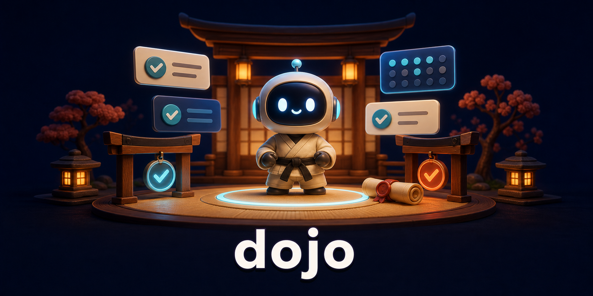
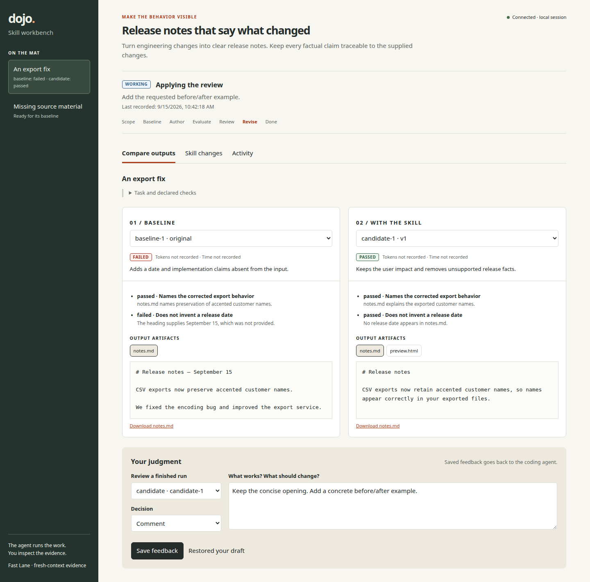

<div align="center">
  <picture>
    <source media="(prefers-color-scheme: dark)" srcset="docs/assets/dojo-banner.png">
    <source media="(prefers-color-scheme: light)" srcset="docs/assets/dojo-banner.png">
    
  </picture>
  <p><strong>Build Agent Skills. See whether they improve your agent.</strong></p>
</div>

<div align="center">

[![License: MIT][license-shield]][license-url]
[![Version: unreleased][version-shield]][version-url]
[![Agent Skills][skills-shield]][skills-url]

</div>

<p align="center">
  <a href="#why-dojo">Why Dojo</a> &middot;
  <a href="#quick-start">Quick Start</a> &middot;
  <a href="#install">Install</a> &middot;
  <a href="https://github.com/AndreRatzenberger/dojo/issues/5">Test Guide</a>
</p>

---

<p align="center">
  <a href="docs/assets/dojo-workbench.png">
    
  </a>
  <br>
  <sub>Illustrative session using UI test fixtures, not a model benchmark. Click to enlarge.</sub>
</p>

Native authoring and the workbench are available on the
[development branch](https://github.com/AndreRatzenberger/dojo/pull/4).
[Install the preview below](#install).

## Why Dojo?

If you write Agent Skills, you need to know whether your instructions help:
does the agent handle the task better, does an edit break a previous result,
and does the skill activate for the right requests?

Dojo creates and improves skills inside your coding agent, with comparisons
you can inspect and feedback you can act on. Use it for a new skill idea, a
recurring failure, a trigger problem, or a behavior claim you want to verify
before release.

- **See what improved.** Compare actual baseline and candidate outputs, with
  fixes, preserved behavior, and missing evidence reported separately.
- **Review the work as it happens.** Inspect skill changes and save feedback
  against the run you are reviewing.
- **Turn examples into a usable skill.** Create a focused package or revise
  an existing one while preserving its supported metadata and resources.
- **Catch regressions and wrong triggers.** Check affected tasks, fresh cases,
  and collisions with neighboring skills.
- **Choose how much evidence you need.** Run focused checks for everyday work
  or an audited campaign for a release claim, including package validation.

Dojo evaluates Agent Skills; general coding plans and code reviews stay with
your existing tools.

## Quick Start

[Install Dojo](#install), start a fresh agent session, and try one of these:

- **Create a skill:** `Use $dojo --lane fast to build a release-notes skill from these examples.`
  You get a candidate skill and a baseline comparison.
- **Fix unwanted activation:** `Use $dojo to check why this skill triggers for unrelated requests.`
  You get trigger findings and a focused revision.
- **Verify a release claim:** `Use $dojo --lane audit to prove this skill changes behavior before we publish it.`
  You get an evidence record and a verdict, including what remains unproven.

These are **prompts to your agent**, including the lane flags. Your host may
expose the skill as `$dojo`, `/dojo`, or a skill picker; there is no `dojo`
shell executable.

## Install

**Development preview:** the authoring and workbench changes are in
[PR #4](https://github.com/AndreRatzenberger/dojo/pull/4). Install its branch:

```bash
git clone --branch feat/native-authoring-workbench https://github.com/AndreRatzenberger/dojo.git dojo-preview
cd dojo-preview
npx skills add ./skills/dojo --skill dojo
```

The [Skills CLI](https://skills.sh/docs/cli) installs the selected skill for
your agent. Add `-g` for a user-level installation. If you already have this
branch checked out, run the last command from its root.

| Requirement | Used for |
|---|---|
| A coding agent with skill support, file/shell access, and fresh execution contexts | Authoring and behavioral comparisons |
| Git and Node.js with npm | The installation commands above |
| Python 3.10+ | The bundled package validator and local workbench |
| A browser that can reach the agent's `127.0.0.1` | Interactive review |

The workbench needs no frontend build, web dependencies, or separate model API
key. Your coding agent supplies model access. If Python or a reachable browser
is unavailable, Dojo continues in chat and files and records the limitation.

## Build, Review, Revise

**Sample flow:** ask Dojo to build a release-notes skill.

```text
Use $dojo --lane fast to build a release-notes skill.

Examples of input:
- Fixed CSV export quoting for fields containing commas.
- Added keyboard shortcuts to switch workspaces.

Group changes by type and keep product names verbatim.
Ask for missing release dates or versions instead of inventing them.
Show me the baseline and candidate outputs; leave final voice approval to me.
```

1. **Compare the result.** Open the workbench link from your agent. Select a
   case and inspect its baseline and candidate outputs.
2. **Inspect the edit.** Open **Skill changes** to see what changed between
   saved skill revisions.
3. **Give feedback.** Select a completed candidate run, choose **Needs changes**
   or **Looks good**, write your feedback, and save it.
4. **Continue in chat.** Tell the agent to read the saved feedback, revise the
   candidate, and rerun the affected case.

**Saving feedback stores your review; it does not start a model run.** The
agent performs the work. The browser shows recorded activity and its timestamp,
compares artifacts, and keeps your feedback attached to the relevant run.
Drafts survive live updates and reload in the same tab.

For the complete hands-on checklist, follow the
[step-by-step test guide](https://github.com/AndreRatzenberger/dojo/issues/5).
It covers creation, revision, saved sessions, feedback conflicts, and keyboard
and mobile use.

## Choose Your Evidence

| Lane | When to use it |
|---|---|
| **Fast** | Everyday creation and focused edits: affected comparisons, bounded revisions, a fresh check, and applicable trigger/package checks. |
| **Audit** | Release, benchmark, or sensitive behavior claims: audited access boundaries, frozen candidates, separately held unseen tasks, and a formal verdict. |

With `--lane auto` (the default), Dojo explains its choice and starts.
An explicit lane stays selected. Use `--no-workbench` for chat/files or
`--quiet` to suppress interactive progress as well.

Fast Lane returns `FAST-LANE PASS`, `FAST-LANE FAIL`, or `UNPROVEN` for the
focused development decision. Audit graduation requires its separate evidence
gates. A contaminated run is `INVALID`;
missing required evidence or human judgment leaves the claim `UNPROVEN`.
If the baseline already passes, Dojo records preserved behavior and cannot
claim an improvement from that comparison.

The [lane guide](skills/dojo/references/lanes.md) explains scope and verdicts.
The [isolation guide](skills/dojo/references/isolation.md) defines the access
boundaries and checks behind audited evidence.

## Evidence You Can Inspect

The [native authoring and workbench validation](evidence/native-authoring-workbench.md)
records 18 passing standard-library tests, browser checks, installed-package
exercises, and routing-proxy results. It also names the limits: Linux/Chromium
was exercised; native Windows/macOS and human acceptance remain unverified.
These checks establish the workflow, not a general gain in output quality.

The [Taste Extractor example](example/taste-extractor/README.md) preserves two
complete campaigns, including baseline outputs, revisions, failed graduation
attempts, and final scorecards. Its index distinguishes the no-skill comparison
from the differences between skill versions.

## Reference And Local Data

The [authoring guide](skills/dojo/references/authoring.md) covers creating and
editing packages. The [workbench reference](skills/dojo/references/workbench.md)
covers session commands, reopening saved work, artifact previews, and feedback.

Raw prompts, outputs, and reviews normally live under
`~/.dojo/<repo-slug>/<skill>/`. The workbench binds to `127.0.0.1`; use its
session link privately. Dojo does not upload or automatically expire these
files. Model data handling remains governed by your coding agent and provider.
Only curated evidence belongs in a public repository.

## Contributing

Use the [manual test guide](https://github.com/AndreRatzenberger/dojo/issues/5)
to review the preview, or [open an issue](https://github.com/AndreRatzenberger/dojo/issues/new)
with reproduction steps and the expected result. For code changes, run:

```bash
python3 -m unittest discover -s tests -v
python3 skills/dojo/scripts/dojo_harness.py validate-skill skills/dojo
```

With `agent-browser` already installed, run
`python3 tests/check_workbench_browser.py` for browser regressions.
See the [changelog](CHANGELOG.md) for release history.

## License

[MIT](LICENSE) © 2026 Andre Ratzenberger

---

Crafted with [Readme Craft](https://github.com/motiful/readme-craft)

[license-shield]: https://img.shields.io/badge/license-MIT-blue
[license-url]: LICENSE
[version-shield]: https://img.shields.io/badge/version-unreleased-orange
[version-url]: CHANGELOG.md
[skills-shield]: https://img.shields.io/badge/format-Agent_Skills-2f6a4f
[skills-url]: skills/dojo/SKILL.md
